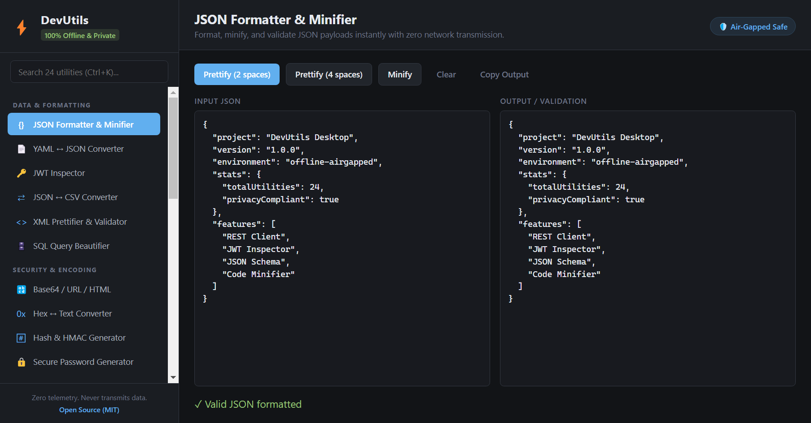
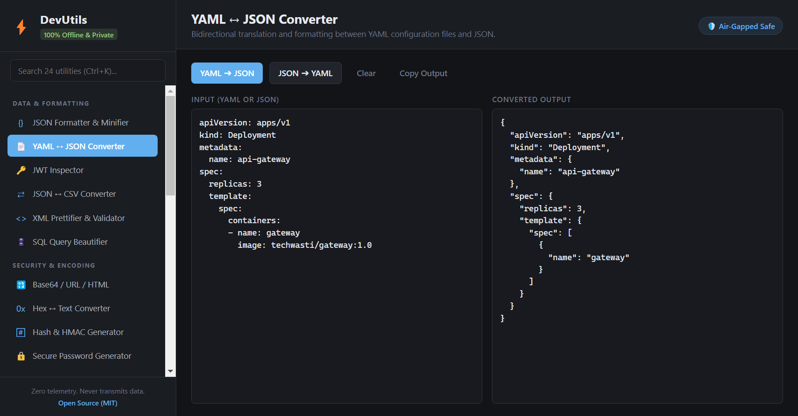
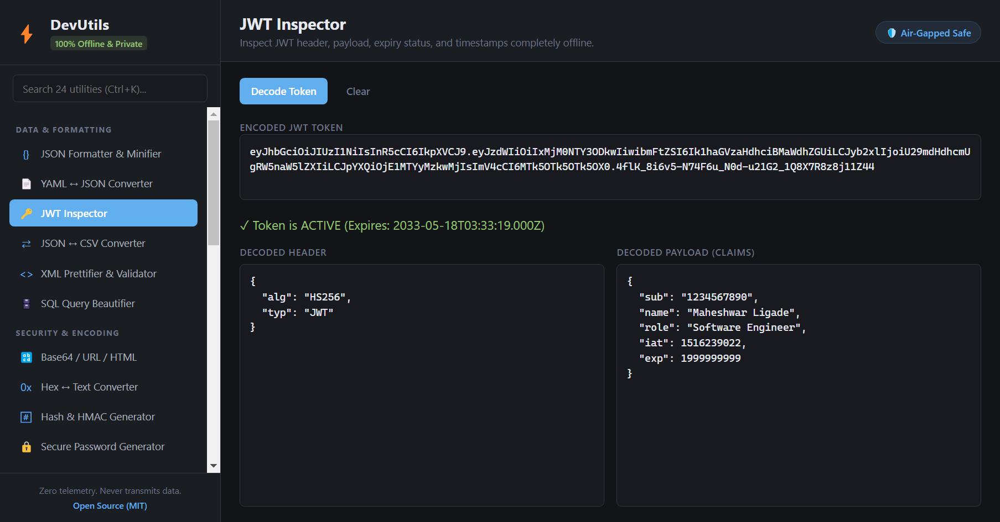
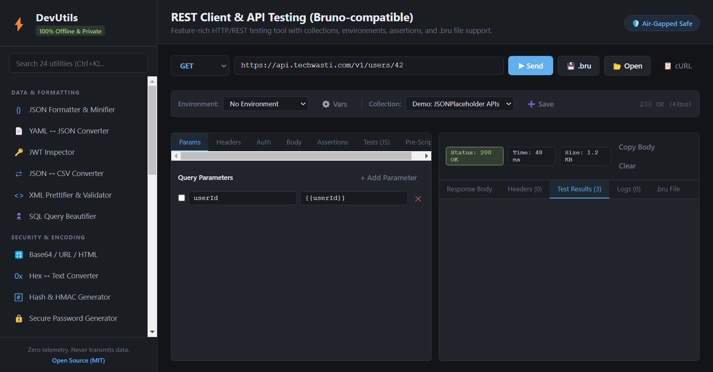
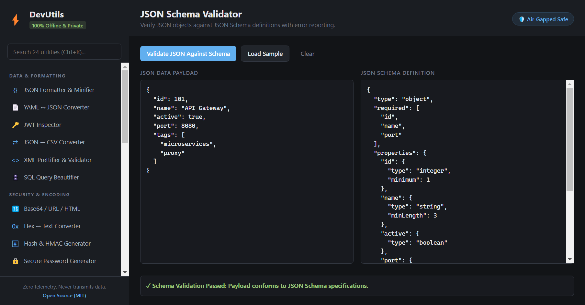
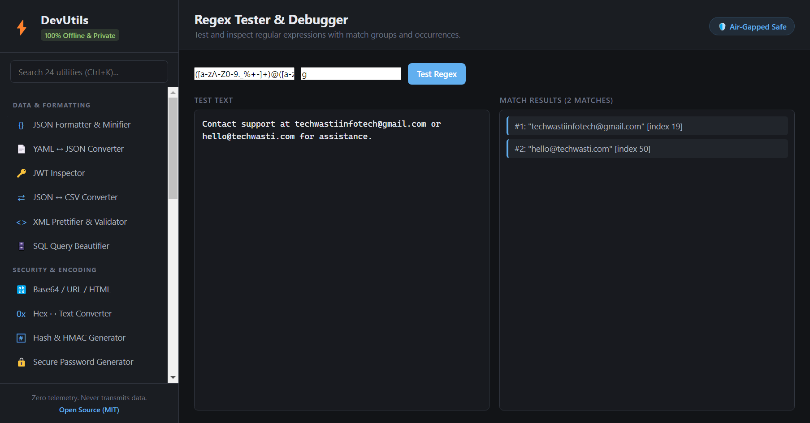
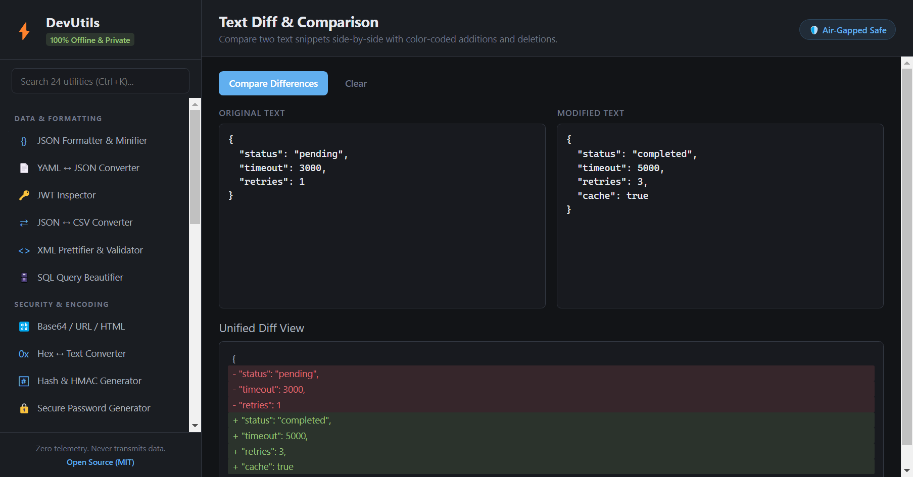
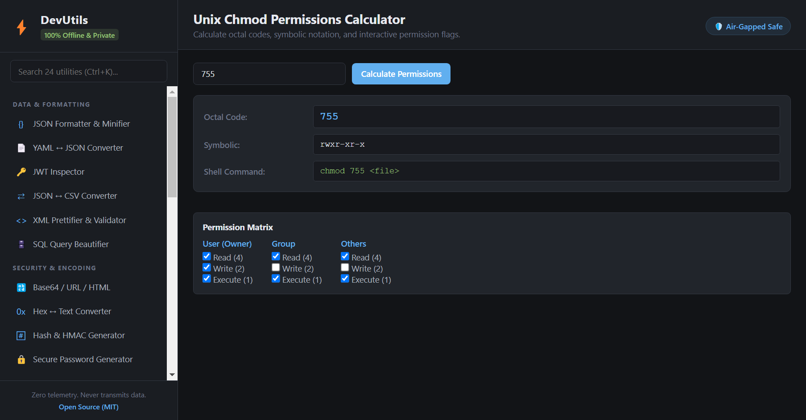

# 🧰 DevUtils Utilities Catalog & Reference

This document provides a comprehensive reference for all **24 offline developer and QA utilities** available in DevUtils.

Every utility runs **100% locally on your desktop machine**, ensuring sensitive credentials, tokens, customer PII, and production payloads never touch the internet.

---

## Quick Navigation

- [1. Data & Formatting Utilities](#1-data--formatting-utilities)
  - [JSON Formatter & Minifier](#json-formatter--minifier)
  - [YAML ↔ JSON Converter](#yaml--json-converter)
  - [JSON ↔ CSV Converter](#json--csv-converter)
  - [XML Formatter & Validator](#xml-formatter--validator)
  - [SQL Formatter & Query Beautifier](#sql-formatter--query-beautifier)
- [2. Security, Tokens & Cryptography](#2-security-tokens--cryptography)
  - [Offline JWT Token Inspector](#offline-jwt-token-inspector)
  - [Cryptographic Hashes & HMAC Generator](#cryptographic-hashes--hmac-generator)
  - [Bcrypt & Password Generator](#bcrypt--password-generator)
- [3. Encoders & Decoders](#3-encoders--decoders)
  - [Base64 / URL / HTML Entity Codec](#base64--url--html-entity-codec)
  - [Hex ↔ UTF-8 Text Converter](#hex--utf-8-text-converter)
- [4. Testing & QA Utilities](#4-testing--qa-utilities)
  - [REST Client & API Testing (Bruno-compatible)](#rest-client--api-testing-bruno-compatible)
  - [JSON Schema Validator](#json-schema-validator)
  - [Regex Tester & Pattern Debugger](#regex-tester--pattern-debugger)
  - [Text Diff & Payload Comparator](#text-diff--payload-comparator)
  - [UUID & GUID Batch Generator](#uuid--guid-batch-generator)
  - [QA Mock Data & User Profile Generator](#qa-mock-data--user-profile-generator)
  - [HTTP Status Code & Header Lookup](#http-status-code--header-lookup)
- [5. DevOps & Environment](#5-devops--environment)
  - [Unix Chmod Permissions Calculator](#unix-chmod-permissions-calculator)
  - [.env ↔ JSON Environment Config](#env--json-environment-config)
  - [Quick Code Minifier (JS / CSS / HTML)](#quick-code-minifier-js--css--html)
- [6. Networking & API Tools](#6-networking--api-tools)
  - [cURL to Code Converter](#curl-to-code-converter)
  - [CIDR / IPv4 Subnet Calculator](#cidr--ipv4-subnet-calculator)
  - [URL & Query String Parser](#url--query-string-parser)
- [7. Time, Math & Text Processing](#7-time-math--text-processing)
  - [Unix Epoch & Timestamp Converter](#unix-epoch--timestamp-converter)
  - [String Case Converter & Text Inspector](#string-case-converter--text-inspector)
  - [Cron Expression Explainer](#cron-expression-explainer)
  - [Markdown to HTML Previewer](#markdown-to-html-previewer)
  - [Lorem Ipsum Text Generator](#lorem-ipsum-text-generator)
  - [Color Palette & Format Converter](#color-palette--format-converter)

---

## 1. Data & Formatting Utilities

### JSON Formatter & Minifier
* **Icon**: `{}`
* **Purpose**: Format, minify, and validate JSON payloads.
* **Features**:
  - Customizable indentation (2-space or 4-space prettification).
  - One-click minification for compact payload transmission.
  - Detailed error reporting with character/line diagnostics for malformed inputs.
* **Use Case**: Cleaning up minified REST API responses and preparing payload bodies for QA tests.

### YAML ↔ JSON Converter
* **Icon**: `📄`
* **Purpose**: Bidirectional translation between YAML and JSON configuration files.
* **Features**:
  - Converts complex YAML hierarchies (mappings, sequences, nested structures) to formatted JSON.
  - Generates clean, human-readable YAML from JSON objects.
  - Preserves types (booleans, integers, floats, strings, nulls).
* **Use Case**: Editing Kubernetes manifests, GitHub Actions workflows, Docker Compose files, and OpenAPI specs.

### JSON ↔ CSV Converter
* **Icon**: `⇄`
* **Purpose**: Bidirectional translation between JSON arrays of objects and CSV spreadsheets.
* **Features**:
  - Automatically identifies header keys from JSON objects.
  - Escapes comma-containing values and quotation marks following RFC 4180.
  - Converts tabular CSV exports back into typed JSON arrays.
* **Use Case**: Exporting database test records to Excel/Sheets or seeding API tests from CSV test matrices.

### XML Formatter & Validator
* **Icon**: `<>`
* **Purpose**: Beautifies and inspects raw XML documents.
* **Features**:
  - Recursively indents nested XML tags with 2 spaces.
  - Validates opening/closing tag balance and reports unmatched tags.
* **Use Case**: Inspecting legacy SOAP endpoints, SAML tokens, and Android XML manifests.

### SQL Formatter & Query Beautifier
* **Icon**: `🗄️`
* **Purpose**: Formats messy, single-line SQL queries into clean, readable code.
* **Features**:
  - Uppercases reserved SQL keywords (`SELECT`, `FROM`, `JOIN`, `WHERE`, `GROUP BY`, `ORDER BY`, `INSERT`, `UPDATE`, `DELETE`, etc.).
  - Automatically breaks clauses onto fresh lines with standardized indentation.
* **Use Case**: Debugging database queries generated by ORMs (Hibernate, Prisma, SQLAlchemy) during QA automation runs.

---

## 2. Security, Tokens & Cryptography

### Offline JWT Token Inspector
* **Icon**: `🔑`
* **Purpose**: Decode and inspect JSON Web Tokens without disclosing secrets to remote websites.
* **Features**:
  - Parses header (`alg`, `typ`) and claims payload (`sub`, `iss`, `aud`, `exp`, `iat`, `nbf`).
  - Evaluates expiration timestamps and provides an active countdown timer.
  - Visual status alerts indicating whether a token is active, expired, or not yet valid.
* **Use Case**: Debugging OAuth2 and OpenID Connect flows in development environments.

### Cryptographic Hashes & HMAC Generator
* **Icon**: `#️⃣`
* **Purpose**: Computes cryptographic checksums locally.
* **Features**:
  - Simultaneous calculation of **MD5**, **SHA-1**, **SHA-256**, and **SHA-512**.
  - Keyed-hash message authentication codes (**HMAC-SHA256** & **HMAC-SHA512**) for signed webhooks.
* **Use Case**: Verifying file integrity and testing webhook signature verification algorithms.

### Bcrypt & Password Generator
* **Icon**: `🔒`
* **Purpose**: Generate cryptographically random secure passwords and test credentials.
* **Features**:
  - Custom length configuration (8 to 128 characters).
  - Toggles for uppercase, lowercase, numbers, and special symbols.
  - Excludes ambiguous characters (e.g. `1`, `l`, `I`, `0`, `O`) if desired.
* **Use Case**: Generating strong credentials for QA test accounts and database seeding.

---

## 3. Encoders & Decoders

### Base64 / URL / HTML Entity Codec
* **Icon**: `🔡`
* **Purpose**: Encode and decode standard web data representations.
* **Features**:
  - UTF-8 safe Base64 encoder and decoder (handles non-ASCII characters without corruption).
  - URL query parameter encoding (`encodeURIComponent`) and decoding.
  - HTML entity escaping and unescaping (`&`, `<`, `>`, `"`, `'`).
* **Use Case**: Decoding basic auth headers, preparing query parameters, and testing XSS sanitizers.

### Hex ↔ UTF-8 Text Converter
* **Icon**: `0x`
* **Purpose**: Bidirectional translation between raw UTF-8 strings and hexadecimal bytes.
* **Features**:
  - Space-delimited and continuous hexadecimal format support.
  - ASCII and multi-byte UTF-8 character support.
* **Use Case**: Analyzing binary packet streams, memory dumps, and protocol payloads.

---

## 4. Testing & QA Utilities

### REST Client & API Testing (Bruno-compatible)
* **Icon**: `🚀`
* **Purpose**: Native offline HTTP/REST client and test runner matching Bruno's feature set.
* **Features**:
  - Full HTTP method support: `GET`, `POST`, `PUT`, `PATCH`, `DELETE`, `HEAD`, `OPTIONS`.
  - Environment variable interpolation using `{{variable_name}}` across URLs, headers, params, and bodies.
  - Authentication options: Bearer Tokens, Basic Auth (`username`/`password`), and API Key placement (Header or Query).
  - Rich payload bodies: JSON (with beautifier), Form URL-Encoded, Plain Text, and XML.
  - Declarative Bruno-style assertions: `res.status: eq 200`, `res.responseTime: lte 2000`, `res.body.property: eq/neq/contains/isDefined/isEmpty`.
  - Post-response JavaScript test sandbox with `test(name, fn)`, `expect()`, and console captures.
  - Pre-request scripts to dynamically prepare headers and environment variables.
  - Bruno `.bru` declarative file format: 1-click import and export.
  - Copy reproducible `cURL` CLI commands.
* **Use Case**: Testing local microservices, debugging REST endpoints, running automated QA assertion suites, and collaborating via Git-friendly `.bru` request files.

### JSON Schema Validator
* **Icon**: `📋`
* **Purpose**: Validates JSON payloads against draft JSON Schema specifications.
* **Features**:
  - Validates object properties, required attributes, and nested hierarchies.
  - Checks numeric ranges (`minimum`, `maximum`), string lengths (`minLength`, `maxLength`), and regex patterns (`pattern`).
  - Detailed error messages showing exact property paths and discrepancies.
  - Includes a one-click sample loader.
* **Use Case**: Verifying API contract compliance, validating schema migration scripts, and preventing breaking schema changes.

### Regex Tester & Pattern Debugger
* **Icon**: `.*`
* **Purpose**: Test regular expressions against text and log files.
* **Features**:
  - Configurable regex flags (`i`, `m`, `s`, `u`).
  - Total match counter, character indexes, and group captures breakdown.
  - Real-time syntax error validation.
* **Use Case**: Verifying validation patterns for form inputs and parsing server log files.

### Text Diff & Payload Comparator
* **Icon**: `±`
* **Purpose**: Compare two text documents or JSON responses.
* **Features**:
  - Unified line-by-line comparison with green `+` additions and red `-` deletions.
  - Helps QA identify subtle discrepancies between expected and actual API responses.
* **Use Case**: Regression testing API contracts and comparing configuration revisions.

### UUID & GUID Batch Generator
* **Icon**: `🎲`
* **Purpose**: Bulk generation of unique identifiers.
* **Features**:
  - Supports UUID v4 (random) and time-based identifiers.
  - Options for uppercase output and hyphen removal.
  - Batch generation from 1 to 500 items at once.
* **Use Case**: Creating unique mock entity IDs for load testing and QA database inserts.

### QA Mock Data & User Profile Generator
* **Icon**: `👥`
* **Purpose**: Generates realistic dummy user records.
* **Features**:
  - Returns complete JSON objects with `id`, `name`, `email`, `role`, `department`, and `status`.
  - Batch size customizable up to 500 records.
* **Use Case**: Populating databases, mocking backend responses, and stress testing UI tables.

### HTTP Status Code & Header Lookup
* **Icon**: `📡`
* **Purpose**: Quick reference for HTTP response codes (1xx, 2xx, 3xx, 4xx, 5xx) and standard headers.
* **Features**:
  - Searchable by code (e.g. `401`, `429`, `503`) or name.
  - Explains caching behavior, retry semantics, and typical causes.
* **Use Case**: Assisting QA engineers in writing API contract assertions.

---

## 5. DevOps & Environment

### Unix Chmod Permissions Calculator
* **Icon**: `🛡️`
* **Purpose**: Calculate octal and symbolic Linux/Unix file permissions.
* **Features**:
  - Bi-directional calculation from octal (e.g. `755`, `644`) or symbolic (e.g. `rwxr-xr-x`).
  - Interactive permission matrix checkboxes for User, Group, and Others (Read: 4, Write: 2, Execute: 1).
  - Generates ready-to-use terminal command: `chmod <octal> <file>`.
* **Use Case**: Setting execution rights on deployment shell scripts, securing private SSH keys (`600`), and configuring CI/CD runners.

### .env ↔ JSON Environment Config
* **Icon**: `⚙️`
* **Purpose**: Bidirectional translation between dotenv (`.env`) format and structured JSON.
* **Features**:
  - Parses key-value environment variables, ignoring comments and stripping quotes.
  - Generates valid `.env` file syntax from JSON configuration maps.
* **Use Case**: Converting container environment variables for Kubernetes ConfigMaps, AWS Secrets Manager, and local `.env.local` files.

### Quick Code Minifier (JS / CSS / HTML)
* **Icon**: `⚡`
* **Purpose**: Fast offline compression for frontend web assets.
* **Features**:
  - Language selection: JavaScript, CSS, and HTML.
  - Removes block and line comments, excessive whitespace, and unnecessary linebreaks.
  - Displays original size, minified size, and percentage saved.
* **Use Case**: Packaging small inline scripts, compacting bookmarklets, and reducing CSS bundle sizes offline.

---

## 6. Networking & API Tools

### cURL to Code Converter
* **Icon**: `🌐`
* **Purpose**: Convert cURL terminal commands into copy-pasteable code.
* **Features**:
  - Extracts HTTP method, URL, headers (`-H`), and request body (`-d` / `--data-raw`).
  - Generates ready-to-run **JavaScript (`fetch`)** and **Python (`requests`)** scripts.
* **Use Case**: Converting requests copied from Chrome DevTools into automated test scripts.

### CIDR / IPv4 Subnet Calculator
* **Icon**: `🌐`
* **Purpose**: Calculate network bounds for IPv4 CIDR blocks.
* **Features**:
  - Computes Subnet Mask, Network Address, Broadcast Address, First Usable Host, Last Usable Host, and Total Usable Hosts.
* **Use Case**: Verifying firewall whitelist ranges and Kubernetes/Docker subnet configurations.

---

## 7. Time, Math & Text Processing

### Unix Epoch & Timestamp Converter
* **Icon**: `⏱️`
* **Purpose**: Convert between Unix epoch numbers and human dates.
* **Features**:
  - Automatically handles both seconds (10 digits) and milliseconds (13 digits).
  - Outputs ISO 8601 UTC, RFC 2822, and Local Date/Time representations.
  - One-click "Current Timestamp" button.
* **Use Case**: Debugging database timestamps, token expiration windows, and log analysis.

### String Case Converter & Text Inspector
* **Icon**: `Aa`
* **Purpose**: Multi-case transformation and string metrics.
* **Features**:
  - Converts text to **camelCase**, **PascalCase**, **snake_case**, **kebab-case**, **CONSTANT_CASE**, and **Title Case**.
  - Analyzes word count, character count (with/without spaces), line count, and UTF-8 byte size.
* **Use Case**: Refactoring code symbols, naming test cases, and checking field length restrictions.

### Cron Expression Explainer
* **Icon**: `⏲️`
* **Purpose**: Translates 5-part cron syntax into human-readable schedules.
* **Features**:
  - Explains minute, hour, day-of-month, month, and day-of-week intervals.
* **Use Case**: Verifying scheduled batch jobs, recurring cron triggers, and QA test schedules.

### Markdown to HTML Previewer
* **Icon**: `📝`
* **Purpose**: Offline renderer translating GitHub Flavored Markdown into HTML with live visual preview.
* **Features**:
  - Renders headings, bold/italic, inline code, lists, blockquotes, and links.
  - One-click copy for clean rendered HTML markup.
* **Use Case**: Drafting release notes, READMEs, bug ticket descriptions, and documentation offline.

### Color Palette & Format Converter
* **Icon**: `🎨`
* **Purpose**: Bidirectional color conversion and visual preview.
* **Features**:
  - Converts between HEX (`#38bdf8`), RGB, RGBA, and HSL.
  - Visual color swatch and interactive native color picker.
* **Use Case**: QA theme verification, UI debugging, and CSS color extraction.

### Lorem Ipsum Text Generator
* **Icon**: `📄`
* **Purpose**: Generates realistic dummy placeholder paragraphs.
* **Features**:
  - Customizable paragraph count (1 to 20 paragraphs).
* **Use Case**: Stress testing UI text overflows, layout shifts, and pagination.

### URL & Query String Parser
* **Icon**: `🔗`
* **Purpose**: Decomposes URLs into component parts and extracts query parameters.
* **Features**:
  - Separates protocol, host, port, path, and hash fragments.
  - Converts URL query string parameters into a formatted JSON object.
* **Use Case**: Debugging complex redirect loops, OAuth callback parameters, and deep links.

